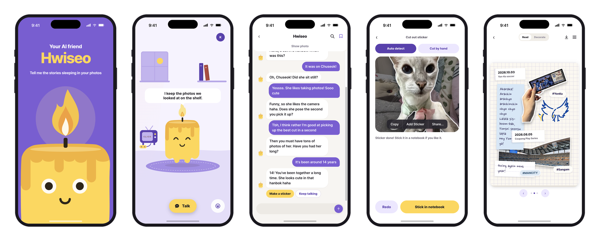

# Hwiseo 휘서

Kyungjin Bae 배경진. Mobile app and motion graphics, 2026

Generative AI can make almost anything look real, yet in its world, the act of living is erased. In an age of instant generation, what stays valuable about being human is lived experience. Hwiseo, a small candle AI friend, shines a light on a forgotten photo and asks about it, so the person who lived that moment can unfold their story again. AI asks and people tell: a use of AI beyond generation. Rather than storing memories, Hwiseo stays beside you so you can keep living with them.

**[Try the prototype](https://hwiseo.vercel.app)**, **[Watch the promo video](https://youtu.be/pocV3tJZphk)**, **[Read the case study](https://kellyb1024.github.io/en/hwiseo.html)**

## Problem

- Taking photos got easy, but the time to look back at them disappeared
- In an age when generative AI can make anything, the value of moments people actually captured and lived gets buried
- The need is not a tool that sorts photos, but a reason to bring forgotten moments back and talk about them

## Solution

- Hwiseo, an AI friend, shines a light on one forgotten photo and asks the person who lived that moment
- AI asks, people tell: no made-up memories, users unfold their own
- Rather than storing memories, it stays beside you and keeps the stories as stickers and a scrapbook

## Process

- Hwiseo designed as a small candle that lights up photos, instead of an AI with a human face
- Conversation flow and prompt design for Hwiseo, ruling out leading questions and generated memories
- One visual language built around the character, from app screens to booth print
- Booth of five art boxes and a four-step stamp tour (video, app, receipt photo, postcard decorating). Receipt photo camera built with Python and OpenCV to run even on the venue's old iMac

## Result

- At the 12th IID Graduation Exhibition "WHY NOT?!", 200+ visitors talked with Hwiseo and took home receipt photos and postcards
- Released as a web app anyone can try
- Interview in KALEIIDOZINE Issue 8

## My role

- Built the whole app on my own, from planning to design and development
- Head TA of the same exhibition, leading its branding and operations
- Character, booth, receipt photo camera, promo video

---

생성형 AI는 무엇이든 그럴듯하게 만들어내지만, 그 세계에서 '살아감'은 지워진다. 모든 것이 빠르게 생성되는 시대에 사람에게 남는 가치는 직접 겪은 경험이다. 'AI 친구 휘서(輝敍)'는 잊힌 사진 한 장에 빛을 비추고(輝), 그 순간을 산 사람이 자기 이야기를 다시 펼치도록(敍) 묻는다. AI가 묻고 사람이 이야기하는, 생성과는 다른 AI의 쓰임이다. 휘서는 기억을 보관하는 대신, 그 기억과 함께 살아갈 수 있도록 곁에 머문다.
