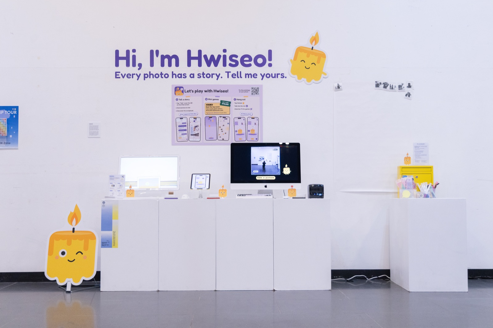
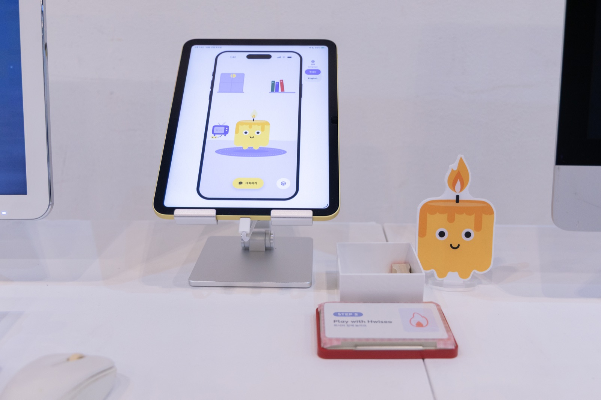
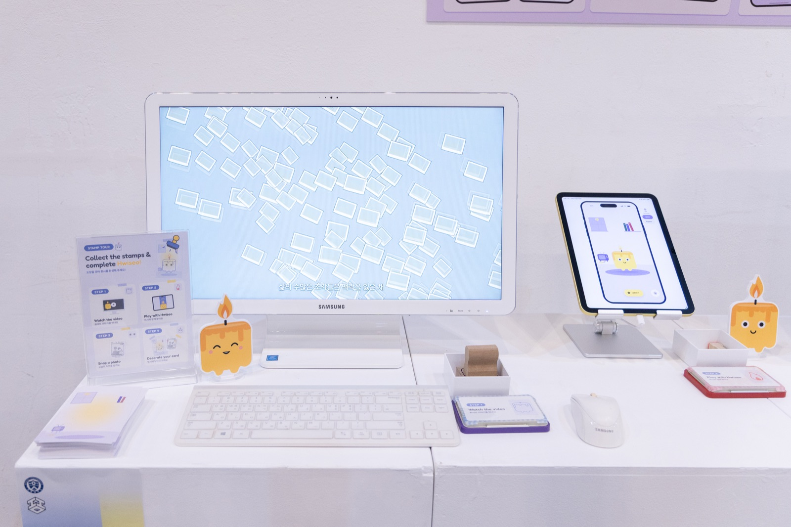
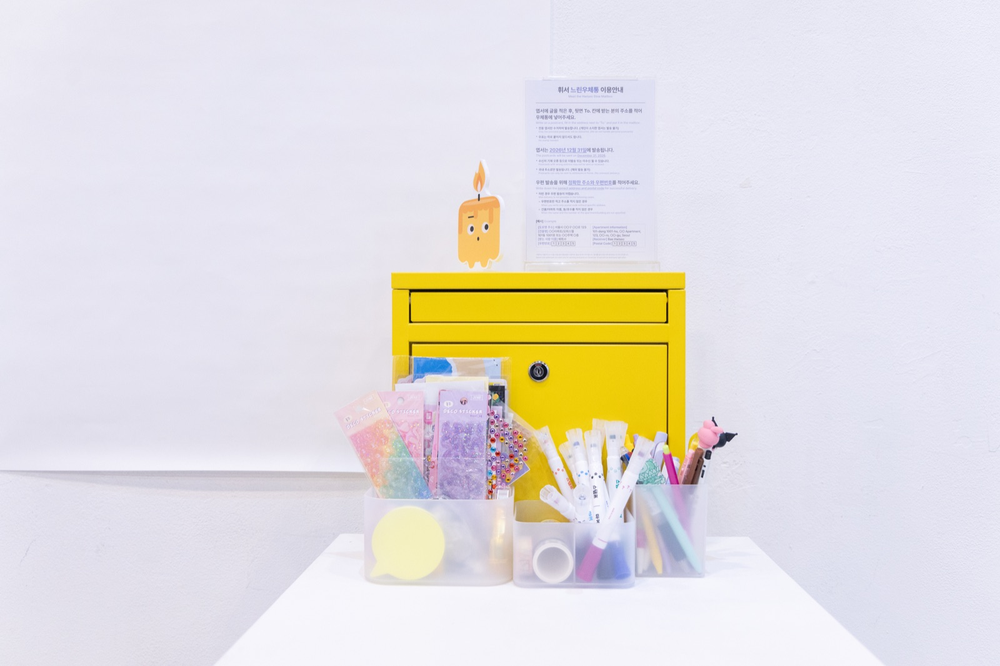

# Hwiseo 휘서

Kyungjin Bae 배경진 · App, Motion Graphics, 2026

Generative AI can make almost anything look real, yet in its world, the act of living is erased. In an age of instant generation, what stays valuable about being human is lived experience. Hwiseo, a small candle AI friend, shines a light on a forgotten photo and asks about it, so the person who lived that moment can unfold their story again. AI asks and people tell: a use of AI beyond generation. Rather than storing memories, Hwiseo stays beside you so you can keep living with them.

생성형 AI는 무엇이든 그럴듯하게 만들어내지만, 그 세계에서 '살아감'은 지워진다. 모든 것이 빠르게 생성되는 시대에 사람에게 남는 가치는 직접 겪은 경험이다. 'AI 친구 휘서(輝敍)'는 잊힌 사진 한 장에 빛을 비추고(輝), 그 순간을 산 사람이 자기 이야기를 다시 펼치도록(敍) 묻는다. AI가 묻고 사람이 이야기하는, 생성과는 다른 AI의 쓰임이다. 휘서는 기억을 보관하는 대신, 그 기억과 함께 살아갈 수 있도록 곁에 머문다.

[프로토타입 열기](https://hwiseo.vercel.app)

| | |
|-|-|
|  |  |
|  | |
